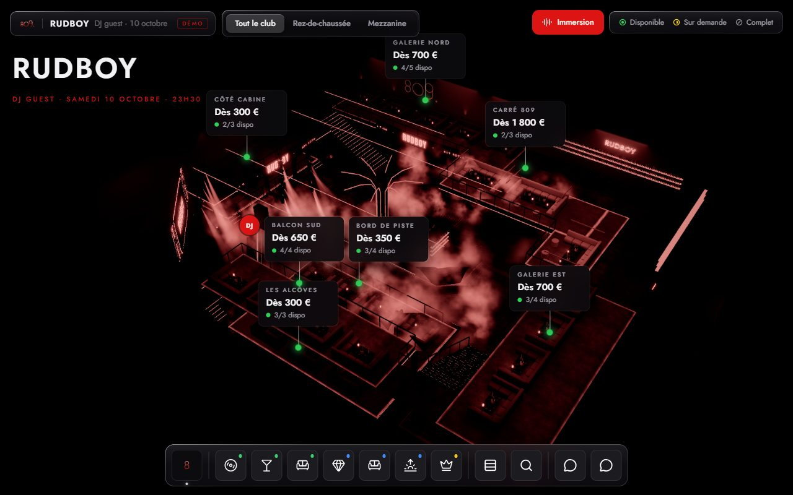
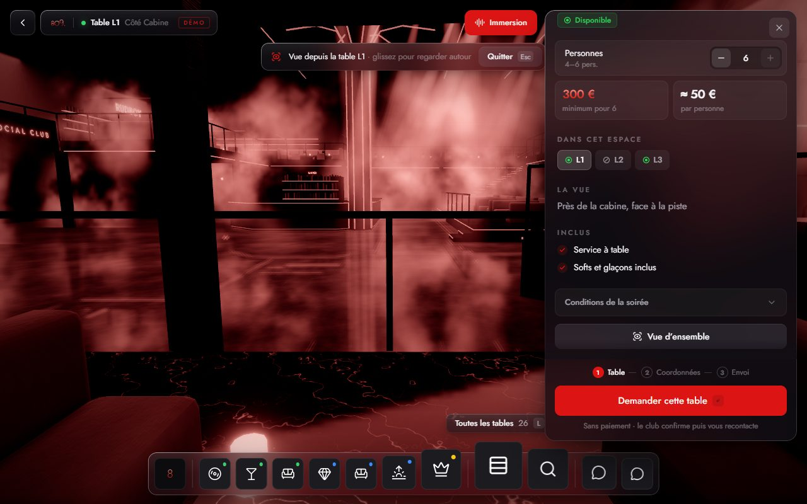
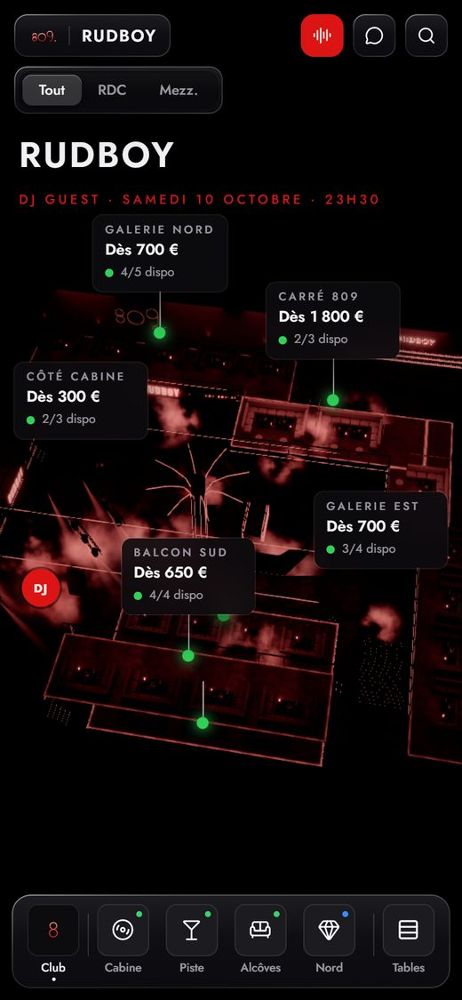
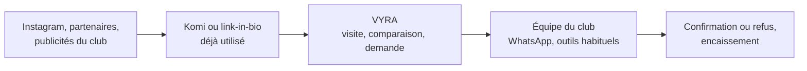
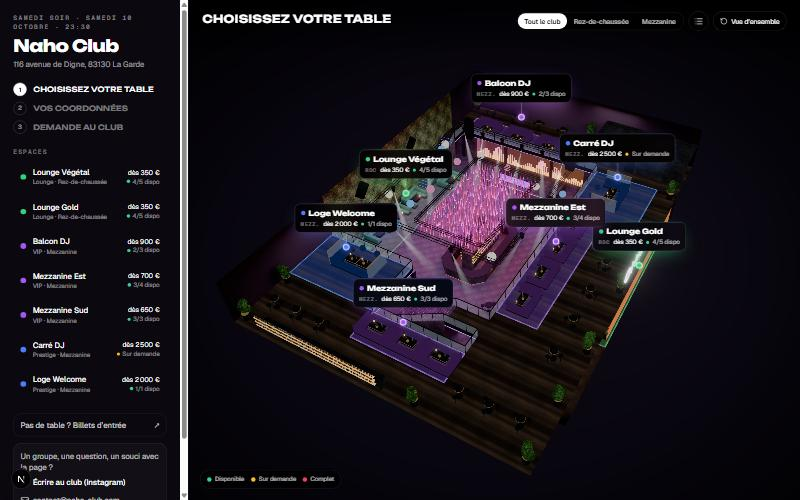
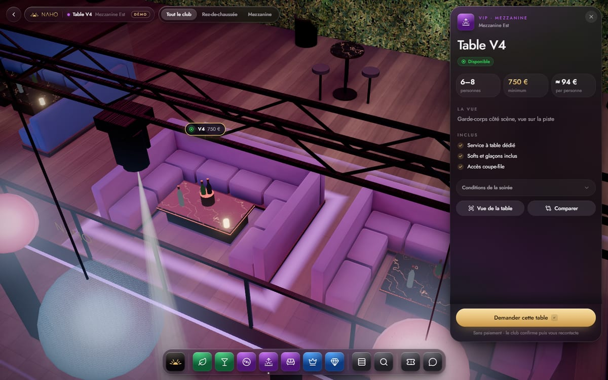
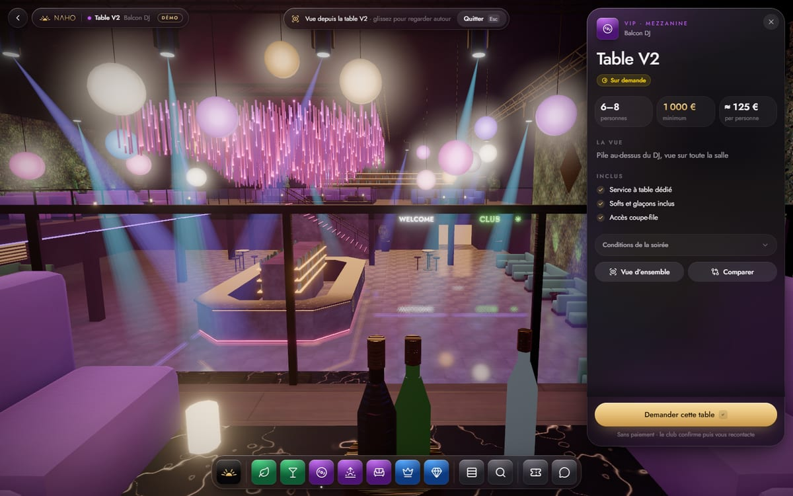
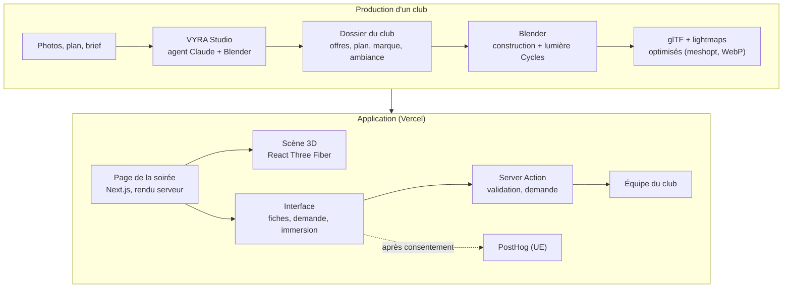

# VYRA

**Faites visiter le club avant de vendre la table.**

VYRA est une mini-application web pensée pour le téléphone qui présente un club en 3D : ses espaces, ses tables, la
vue depuis chacune, la capacité, le prix ou le minimum de consommation, les prestations. L'acheteur comprend ce qu'il
réserve, compare et envoie une demande. L'équipe du club confirme et encaisse avec ses outils habituels.



> **Où on en est (octobre 2026)** : prototype en ligne, premier pilote gratuit en préparation. Les démos utilisent des
> plans, tables et prix provisoires, non validés par les clubs. Leur formulaire ne transmet aucune demande.

**Sommaire** : [En bref](#en-bref) · [Le problème](#le-problème) · [Le produit](#le-produit) ·
[Intégration au club](#comment-vyra-sintègre-au-club) · [Description business](#description-business) ·
[Vision et feuille de route](#vision-et-feuille-de-route) · [Démos](#démos) ·
[Description technique](#description-technique) · [Démarrer](#démarrer-en-local) · [Contribuer](#contribuer) ·
[Documentation](#documentation) · [Équipe](#équipe)

## En bref

- **Pour qui** : les clubs et organisateurs de soirées qui vendent des tables et des espaces premium à des prix
  différents.
- **Ce que voit l'acheteur** : la salle en 3D sur son téléphone et, pour chaque table, sa vue, sa capacité, son prix et
  ses prestations.
- **Ce que reçoit le club** : une demande claire (table, nombre de personnes, heure, contact) qu'il confirme ou refuse.
- **Ce que VYRA ne fait pas** : ni billetterie, ni paiement, ni réservation automatique. Le club garde la main.
- **Comment on prouve la valeur** : un pilote gratuit sur une soirée, mesuré sur cinq critères distincts (H1 à H5).

## Le problème

Une table VIP ne se réduit pas à un nom et à un prix. Deux tables d'une même zone peuvent différer par la vue, la
proximité du DJ, la capacité, l'accès, les prestations ou le minimum de consommation. Aujourd'hui, l'acheteur voit le
plus souvent une liste de tables et de prix sans comprendre ce qu'il achète. Il choisit la moins chère, pose les mêmes
questions sur WhatsApp, ou renonce. L'équipe du club, elle, répète les mêmes explications soirée après soirée.

## Le produit

VYRA rend chaque différence **visible et intelligible** : « cette table coûte davantage parce qu'elle se trouve ici,
donne cette vue et inclut ces prestations ». Le club choisit ses offres et ses prix ; l'application représente
fidèlement ce qui sera livré.

| Vue depuis une table                                                   | Sur téléphone                                                            |
| ---------------------------------------------------------------------- | ------------------------------------------------------------------------ |
|  |  |

- **Visite 3D sur mobile** : la salle s'ouvre en quelques secondes et se parcourt du doigt. Les zones sont épinglées
  avec leur prix de départ et leur disponibilité déclarée par le club ; un repère montre où joue le DJ.
- **Vue depuis la table** : on s'assoit virtuellement pour voir la piste, la cabine et les écrans depuis sa place.
- **Fiche de table** : capacité, prix ou minimum, part par personne, prestations incluses, conditions de la soirée.
- **Demande courte** : table, nombre de personnes, heure d'arrivée et coordonnées. Un identifiant de demande et un
  accusé de réception honnête : _ce n'est pas une confirmation_, le club recontacte.
- **Contact de secours** : WhatsApp, Instagram ou téléphone du club, toujours accessibles si quelque chose échoue.
- **Immersion de la soirée** : la salle passe en mode nuit aux couleurs de l'événement, les écrans diffusent le motion
  design de la soirée et, si le visiteur l'accepte, la musique joue avec des lumières calées sur ses temps et ses drops.
- **L'identité du club** : couleurs, logo, ton de l'interface, soirée à l'affiche avec son DJ.
- **Pour tous** : liste des tables quand la 3D ne peut pas tourner, animations coupées pour les visiteurs qui le
  demandent, aucun cookie d'analyse avant consentement.

## Comment VYRA s'intègre au club



Le club garde tout ce qui fonctionne déjà : Shotgun pour les billets s'il l'utilise, WhatsApp pour les échanges, ses
campagnes, ses créatives et ses budgets. VYRA ajoute un lien, héberge l'expérience et achemine les demandes.

Cinq règles ne bougent jamais, dans le produit comme dans le discours commercial :

1. Une **demande** n'est ni une réservation confirmée ni un blocage de stock.
2. Le club **confirme, refuse et encaisse dans ses outils**. Pas de paiement intégré.
3. Offres et médias **validés par le club** et datés. Pas de disponibilité « temps réel » sans source fiable.
4. Un **contact de secours** toujours visible en cas d'échec de la page, du rendu ou de l'envoi.
5. **Inconnu = inconnu** : aucun montant, aucune source, aucun retour sur investissement inventés.

## Description business

### Marché et cible

La cible prioritaire est la vente de **tables et d'expériences premium** (VIP, carrés, balcons, bord de piste), là où
les différences entre offres ont une valeur économique. Le client idéal : un club ou un organisateur avec plusieurs
tables ou zones à prix différents, une prochaine soirée, des offres stables et une équipe qui suit réellement ses
réservations. Les acheteurs d'entrées classiques peuvent découvrir l'expérience, mais VYRA ne refait pas la
billetterie.

### Proposition de valeur, à mesurer et non à promettre

L'hypothèse centrale : **voir ce qui distingue les tables rend les écarts de prix compréhensibles**. Cela pourrait
augmenter les réservations confirmées, la valeur des tables vendues ou la fluidité du traitement. Ces effets se
mesurent séparément, et aucun n'est acquis.

| Hypothèse            | Ce que l'on mesure                                                 | Ce qui ne suffit pas                     |
| -------------------- | ------------------------------------------------------------------ | ---------------------------------------- |
| **H1 Compréhension** | L'acheteur localise l'offre et explique son prix                   | « La démo est belle »                    |
| **H2 Conversion**    | Demandes qualifiées et réservations confirmées, par visiteur       | Des clics ou des formulaires sans suite  |
| **H3 Valeur**        | Part des tables premium vendues, revenu réellement encaissé        | Un panier plus haut avec moins de ventes |
| **H4 Opérations**    | Moins d'échanges et de questions répétées, temps de traitement     | Un canal de plus à gérer pour l'équipe   |
| **H5 Adoption**      | Le club réutilise l'outil et envisage de payer, mesurés séparément | Un compliment ou un accord de principe   |

### Offre et modèle

- **Pilote gratuit** sur une soirée, au périmètre écrit : tables représentées, validations, responsable des demandes,
  canal de secours et données du bilan. Puis un bilan factuel avec le club.
- **Partage des rôles** : VYRA prépare l'expérience, configure les offres, fournit le lien, assure la réception des
  demandes et produit le bilan. Le club fournit son plan, ses médias et ses prix, valide le contenu, diffuse le lien,
  traite les demandes et partage les résultats utiles à l'évaluation.
- **Modèle commercial** : à fixer selon la valeur observée, parmi des frais de mise en place, un abonnement, un prix
  par soirée ou une commission sur des réservations vérifiées. Aucun tarif n'est arrêté et aucun résultat chiffré
  n'est garanti.

### Ce qui rend VYRA reproductible

- **Un club produit en heures, pas en semaines** : VYRA Studio génère l'expérience 3D d'un nouveau club à partir de
  ses photos, de son plan et d'un brief, en environ 25 minutes de génération ; l'équipe la revoit et la corrige.
- **Un rendu soigné sur un téléphone moyen** : la lumière est précalculée, l'expérience tient dans un lien, sans
  application à installer ni serveur 3D.
- **Une brique qui s'ajoute** : rien n'est remplacé chez le club, donc rien à migrer pour essayer.

## Vision et feuille de route

Chaque étape est une **porte de décision** : on ne passe à la suivante que si la précédente est validée par des faits.

| Étape                                   | Objectif                                                                                                         |
| --------------------------------------- | ---------------------------------------------------------------------------------------------------------------- |
| **G0** Audit et qualification           | Comprendre les usages ; qualifier un premier club (offres différenciées, soirée, décideur)                       |
| **G1** Accord et MVP                    | Accord écrit pour le pilote, contenus validés, réception des demandes vérifiée                                   |
| **G2** Première soirée                  | Usage réel, bilan honnête de H1 à H5, décision d'itérer, de simplifier ou d'arrêter                              |
| **G3** Récurrence                       | Plusieurs soirées réelles chez le premier club                                                                   |
| **G4** Dix autres clubs                 | Onze clubs en usage réel, stabilité vérifiée, négociations fondées sur la valeur                                 |
| **G5** V2 conditionnelle : link-in-bio  | Une page propre événements, billets et tables, seulement si les besoins communs la justifient                    |
| **G6** V3 conditionnelle : signaux Meta | Remontée des confirmations vers les campagnes (Pixel, Conversions API) si données et consentements le permettent |

À plus long terme, VYRA pourrait faire **vivre la soirée avant d'y aller** : aperçus immersifs de l'ambiance, du
DJ, du service à table et des différentes zones. Seulement s'ils restent fidèles à l'expérience vendue. La 3D n'est
pas une fin en soi : si un plan interactif avec photos fait aussi bien pour moins cher, le produit se simplifiera.
Onze clubs en usage ne prouvent pas la volonté de payer ; si l'usage est réel sans paiement envisagé, la valeur ou le
modèle seront revus avant toute V2.

## Démos

| Démo                           | Adresse                                                                          | Ce qu'elle montre                                            |
| ------------------------------ | -------------------------------------------------------------------------------- | ------------------------------------------------------------ |
| 809 Social Club, soirée Rudboy | [`/809-social-club/rudboy`](https://vyra-dice.vercel.app/809-social-club/rudboy) | Immersion de nuit, motion design des écrans, interface sobre |
| Naho Club, samedi              | [`/naho/samedi`](https://vyra-dice.vercel.app/naho/samedi)                       | Visite, fiches de tables, vue depuis la table, comparatif    |

Ce sont des **démos de prospection** : plans reconstitués, tables, capacités et prix provisoires, non validés par les
clubs. Le formulaire fonctionne en mode démo et ne transmet aucune demande.

| Naho : vue d'ensemble                    | Table V4                              | Vue depuis la table                  |
| ---------------------------------------- | ------------------------------------- | ------------------------------------ |
|  |  |  |

## Description technique

### Vue d'ensemble



### Stack

| Couche        | Choix                                                                             |
| ------------- | --------------------------------------------------------------------------------- |
| Application   | Next.js 16 (App Router, rendu serveur, Server Actions), React 19, TypeScript      |
| Interface     | Tailwind CSS v4, shadcn/ui, motion                                                |
| 3D            | three.js, React Three Fiber, drei, postprocessing, camera-controls                |
| État          | zustand (partagé entre la scène 3D et l'interface sans rendu React par image)     |
| Validation    | zod (mêmes schémas côté client et serveur), react-hook-form                       |
| Production 3D | Blender 5.1 piloté par scripts Python, lumière précalculée Cycles, gltf-transform |
| Motion design | Remotion (studio de motion design de l'équipe)                                    |
| Mesure        | PostHog, région UE                                                                |
| Envoi         | Resend (e-mails), API Cloud de WhatsApp (Meta), appelés par la Server Action      |
| Hébergement   | Vercel (production et preview par pull request)                                   |
| Qualité       | ESLint, Prettier, Vitest, GitHub Actions                                          |
| À venir (G1)  | Supabase (demandes et statuts, région UE)                                         |

### Points d'architecture

- **Un club = un dossier.** Tout ce qui est propre à un club vit dans `clubs/<slug>/` : la soirée en vente
  (`content.json`), le plan en mètres (`layout.json`), l'identité (`brand.json`), l'ambiance 3D (`ambiance.json`), la
  scène Blender et le bundle web. Le code commun ne nomme aucun club. `defineClub` valide les fichiers avec zod et
  recoupe contenu et plan, et des tests de contrat tournent sur chaque club. Ajouter un club, c'est créer son dossier et
  l'enregistrer dans `clubs/registry.ts`.
- **La 3D est générée, jamais retouchée à la main.** Le plan est la source de vérité partagée entre Blender et le web.
  `art/scripts/build_club.py` construit la scène, Cycles précalcule la lumière, l'export glTF est optimisé. Le rendu
  « fait pro » à un coût GPU quasi nul. Budget visé : GLB de 4 Mo au plus, 100 appels de dessin au plus, interactif
  en moins de 3 s en 4G, 60 images par seconde sur un iPhone 12 et 30 sur un Android de milieu de gamme.
- **Un chargement fluide.** Les textures procédurales sont générées dans un worker, envoyées au GPU une par image, et
  les shaders sont compilés avant la première image. Pendant ce temps, la boucle vidéo de la soirée occupe l'écran de
  chargement : une vidéo se décode hors du fil principal et ne saccade pas.
- **L'immersion.** Étalonnage de nuit en post-traitement, faisceaux des lyres, fumée, écrans qui jouent les boucles de
  la soirée. Sur accord du visiteur, la musique est analysée une fois dans un worker (tempo, grille des temps, mesures,
  coupures, drops) et le show suit la position réellement entendue, latence de sortie déduite. Un morceau non libre de
  droits peut être scellé (AES-GCM) pour ne se jouer que depuis un lien privé de démonstration.
- **Les demandes.** Server Action, même schéma zod qu'au navigateur, limitation de débit, identifiant lisible propre
  au club (`NHO-7K2QX`), accusé honnête. La demande part par e-mail (Resend) et WhatsApp (Meta), et l'acheteur reçoit
  un récapitulatif aux couleurs du club ; en démo, tout part vers l'équipe, jamais vers le club
  (`docs/notifications.md`). La base de données arrive avec le premier pilote.
- **La mesure.** Taxonomie d'événements alignée sur H1 à H5, consentement d'abord, aucune donnée personnelle (nom,
  téléphone) dans les événements.
- **VYRA Studio** (`studio/`). L'application locale de l'équipe : un agent (Claude Code) lit les sources d'un club,
  écrit sa note de recherche et sa spécification ; Blender construit et éclaire la salle ; l'agent revoit les rendus,
  l'équipe commente, et le club part en pull request. Les photos et plans reçus d'un club restent sur la machine.

### Arborescence

```
clubs/          un dossier par club (offres, plan, marque, ambiance, scène, bundle web) + registry.ts
src/app/        pages Next.js : accueil, /[club]/[event], Server Actions
src/components/ scene/ (3D, effets, immersion), experience/ (interface), analytics/
src/lib/        schémas zod, état, musique et analyse du morceau, analytics, géométrie du lieu
src/server/     réception des demandes, limitation de débit
art/scripts/    constructeur Blender, précalcul de la lumière, export
scripts/        optimisation des GLB, copie des bundles, scellement d'un morceau
studio/         VYRA Studio, l'application locale de production des clubs
docs/           cadrage, architecture, pipeline 3D, clubs, mesure, workflow GitHub
```

## Démarrer en local

Prérequis : Node 24, pnpm 9 (`corepack enable`), Git LFS pour les sources 3D.

```bash
pnpm install
cp .env.example .env.local
pnpm dev                     # http://localhost:3000/809-social-club/rudboy
```

Tester sur son téléphone, sur le même Wi-Fi que l'ordinateur :

```bash
pnpm dev --hostname 0.0.0.0  # puis http://<IP-de-l-ordinateur>:3000/809-social-club/rudboy
```

Les performances se jugent en production (`pnpm build && pnpm start`) : en développement, three.js est compilé à la
volée.

| Commande               | Rôle                                                              |
| ---------------------- | ----------------------------------------------------------------- |
| `pnpm check`           | lint, typage et tests (à faire passer avant de pousser)           |
| `pnpm format`          | mise en forme Prettier                                            |
| `pnpm assets:optimize` | bundle web d'un club depuis son export Blender                    |
| `pnpm studio`          | VYRA Studio sur <http://localhost:3300> (voir `studio/README.md`) |

## Contribuer

- **Linear** (équipe `VYR`, projet « Réservation immersive pour clubs ») porte le _quoi_ et le _pourquoi_ ; GitHub
  porte le _comment_. Aucune tâche ne vit seulement dans GitHub.
- Branches `<type>/VYR-<n>-<slug>` depuis `main`, commits atomiques en Conventional Commits (en anglais), pull request
  avec captures pour tout changement visuel, merge en rebase. `main` est protégée : pull request obligatoire, CI verte.
- Le dépôt est public : ni photo ni plan reçus d'un club (`clubs/<slug>/private/` reste local), aucun secret, aucune
  offre réelle avant l'accord écrit d'un club.

## Documentation

| Document                                     | Contenu                                                    |
| -------------------------------------------- | ---------------------------------------------------------- |
| [docs/linear.md](docs/linear.md)             | Cadrage, jalons G0 à G6, règles produit, responsabilités   |
| [docs/architecture.md](docs/architecture.md) | Architecture, modèle de données, flux d'une demande        |
| [docs/clubs.md](docs/clubs.md)               | Un dossier par club, ajouter un club, immersion et musique |
| [docs/3d-pipeline.md](docs/3d-pipeline.md)   | Production d'un club en 3D, du plan au navigateur          |
| [docs/analytics.md](docs/analytics.md)       | Événements et lecture de H1 à H5                           |
| [docs/github.md](docs/github.md)             | Branches, commits atomiques, pull requests, CI             |
| [studio/README.md](studio/README.md)         | VYRA Studio : installation, workflow d'un club, partage    |

## Équipe

- **Pierre** : développement, data et analytics
- **Jonathan** : vente, audit
- **Ensemble** : produit et design, implémentation et adoption, opérations et support
